# AeroGestión: Historias de Usuario

> Formato: **GitHub Issues**. Cada historia se puede copiar tal cual como un *issue*
> usando la plantilla `.github/ISSUE_TEMPLATE/historia-de-usuario.md`.
>
> **Notación:** *Como* [rol] *quiero* [acción] *para* [beneficio]
> **Criterios de aceptación:** formato Gherkin (*Dado / Cuando / Entonces*)
> **Prioridad:** MoSCoW (Must / Should / Could) · **Estimación:** Story Points (Fibonacci)

## Roles

| Rol | Descripción |
|---|---|
| **Visitante** | Persona no registrada que consulta vuelos |
| **Pasajero** | Usuario registrado que reserva vuelos y elige asientos |
| **Administrador** | Empleado de la aerolínea que gestiona flota y vuelos |

## Épicas

| Épica | Historias |
|---|---|
| E1: Autenticación y cuentas | HU-01, HU-02, HU-15 |
| E2: Gestión de flota | HU-03, HU-04, HU-05, HU-16, HU-17 |
| E3: Gestión de vuelos | HU-06, HU-07, HU-08, HU-18, HU-19 |
| E4: Búsqueda de vuelos | HU-09, HU-10, HU-20, HU-21, HU-22 |
| E5: Reservas y asientos | HU-11, HU-12, HU-13, HU-14, HU-23, HU-24 |

---

## E1: Autenticación y cuentas

### HU-01 · Registro de pasajero
**Labels:** `historia-de-usuario` `epica:autenticacion` `prioridad:must`
**Estimación:** 3 SP

**Como** visitante
**quiero** registrarme con mis datos personales
**para** poder reservar vuelos con mi propia cuenta.

#### Criterios de aceptación
- [ ] **Dado** que estoy en el formulario de registro, **cuando** ingreso nombre, apellido, email, documento, teléfono, fecha de nacimiento y contraseña válidos, **entonces** se crea mi cuenta con rol `PASAJERO`.
- [ ] **Dado** que el email ya está registrado, **cuando** intento registrarme, **entonces** el sistema muestra *"El email ya está en uso"* y no crea la cuenta.
- [ ] **Dado** que la contraseña tiene menos de 8 caracteres, **cuando** envío el formulario, **entonces** se rechaza el registro.
- [ ] La contraseña se guarda cifrada (BCrypt), nunca en texto plano.

**Notas técnicas:** `POST /api/auth/registro` · colección `usuarios`

**Mockup:**

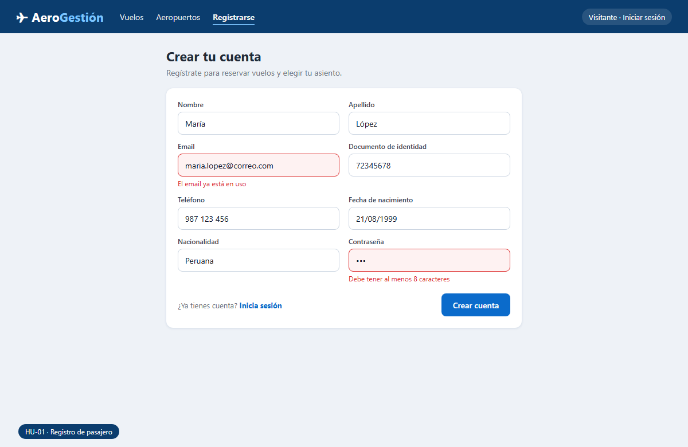

---

### HU-02 · Inicio de sesión
**Labels:** `historia-de-usuario` `epica:autenticacion` `prioridad:must`
**Estimación:** 3 SP

**Como** pasajero o administrador
**quiero** iniciar sesión con mi email y contraseña
**para** acceder a las funciones de mi rol.

#### Criterios de aceptación
- [ ] **Dado** que mis credenciales son correctas, **cuando** inicio sesión, **entonces** el sistema me identifica y me da acceso a las funciones de mi rol.
- [ ] **Dado** que mis credenciales son incorrectas, **cuando** inicio sesión, **entonces** veo *"Credenciales inválidas"*.
- [ ] **Dado** que soy pasajero, **cuando** intento entrar a una ruta de administrador, **entonces** recibo un error 403.

**Notas técnicas:** `GET /api/auth/yo` · autenticación HTTP Basic (Spring Security)

**Mockup:**

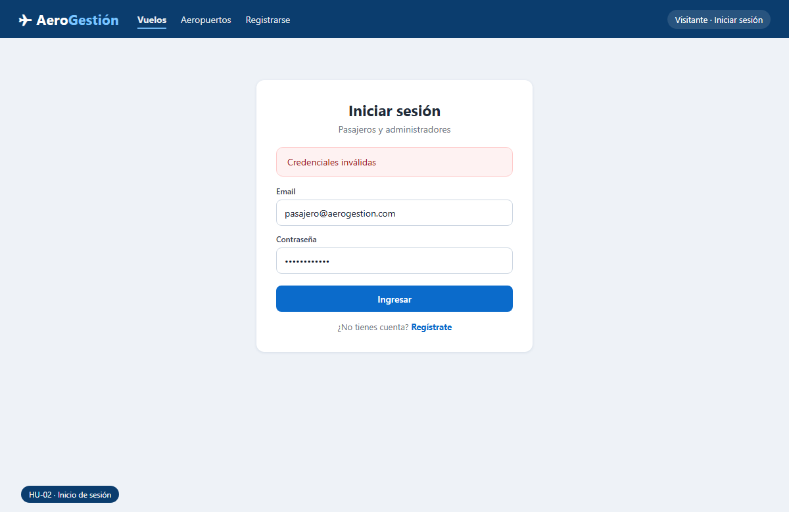

---

### HU-15 · Consultar mi perfil
**Labels:** `historia-de-usuario` `epica:autenticacion` `prioridad:could`
**Estimación:** 1 SP

**Como** pasajero o administrador
**quiero** ver los datos de mi cuenta
**para** confirmar con qué usuario y rol estoy trabajando.

#### Criterios de aceptación
- [ ] **Dado** que inicié sesión, **cuando** abro *Mi perfil*, **entonces** veo mi nombre, apellido, email y rol.
- [ ] Nunca se muestra mi contraseña.
- [ ] **Dado** que no inicié sesión, **cuando** intento abrir mi perfil, **entonces** se me pide iniciar sesión (401).

**Notas técnicas:** `GET /api/auth/yo`

**Mockup:**

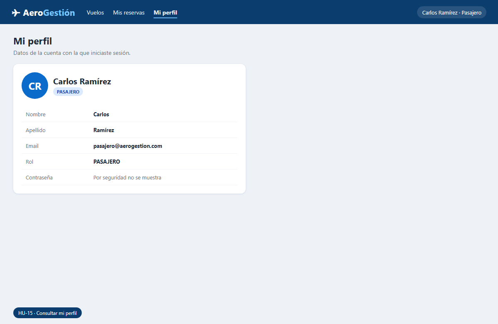

---

## E2: Gestión de flota

### HU-03 · Registrar avión
**Labels:** `historia-de-usuario` `epica:flota` `prioridad:must`
**Estimación:** 5 SP

**Como** administrador
**quiero** registrar un avión con su matrícula, modelo, fabricante y año
**para** tenerlo disponible al programar vuelos.

#### Criterios de aceptación
- [ ] **Dado** que ingreso datos válidos, **cuando** guardo el avión, **entonces** queda registrado con estado `ACTIVO`.
- [ ] **Dado** que la matrícula ya existe, **cuando** intento guardarlo, **entonces** el sistema rechaza el registro.
- [ ] **Dado** que hay aviones registrados, **cuando** abro la sección *Flota*, **entonces** veo la lista con matrícula, modelo, capacidad y estado.

**Notas técnicas:** `GET /api/admin/aviones`, `POST /api/admin/aviones` · colección `aviones`

**Mockup:**

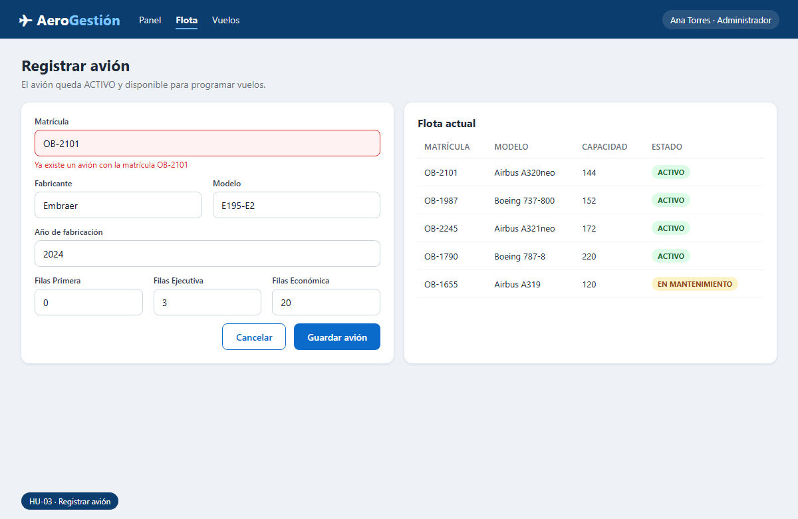

---

### HU-04 · Actualizar estado de un avión
**Labels:** `historia-de-usuario` `epica:flota` `prioridad:should`
**Estimación:** 3 SP

**Como** administrador
**quiero** cambiar el estado de un avión (activo, en mantenimiento, fuera de servicio)
**para** evitar que se asigne a vuelos un avión no disponible.

#### Criterios de aceptación
- [ ] **Dado** un avión `ACTIVO`, **cuando** lo marco `EN_MANTENIMIENTO`, **entonces** ya no aparece como opción al programar vuelos.
- [ ] **Dado** un avión con vuelos programados a futuro, **cuando** intento ponerlo `FUERA_DE_SERVICIO`, **entonces** el sistema me advierte qué vuelos están afectados.

**Notas técnicas:** `PATCH /api/admin/aviones/{matricula}/estado`

**Mockup:**

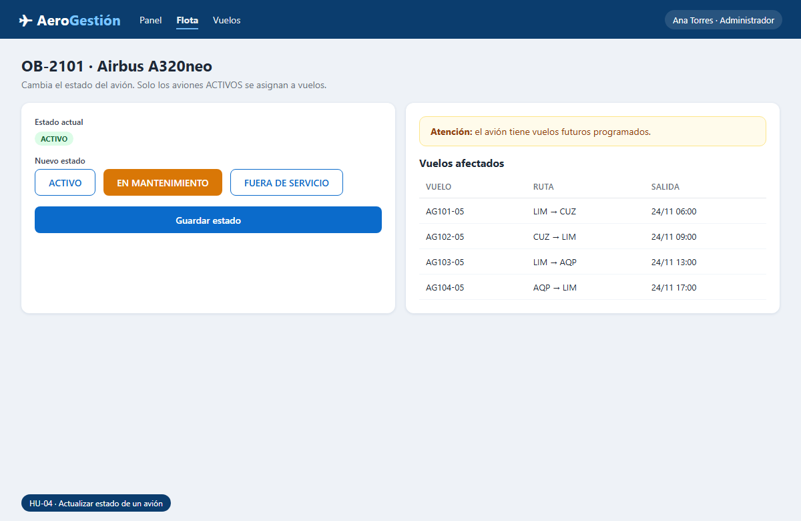

---

### HU-05 · Configurar mapa de asientos
**Labels:** `historia-de-usuario` `epica:flota` `prioridad:must`
**Estimación:** 5 SP

**Como** administrador
**quiero** definir la distribución de asientos de un avión por clase (Primera, Ejecutiva, Económica)
**para** que los pasajeros puedan elegir asiento al reservar.

#### Criterios de aceptación
- [ ] **Dado** un avión registrado, **cuando** indico filas y letras para cada clase, **entonces** se generan los asientos (ej. `1A`, `12C`).
- [ ] La capacidad total del avión se calcula automáticamente a partir de los asientos.
- [ ] Cada clase tiene un factor de precio: Económica ×1.0, Ejecutiva ×1.8, Primera ×3.0.

**Notas técnicas:** `PUT /api/admin/aviones/{matricula}/asientos` · asientos embebidos en el documento del avión

**Mockup:**

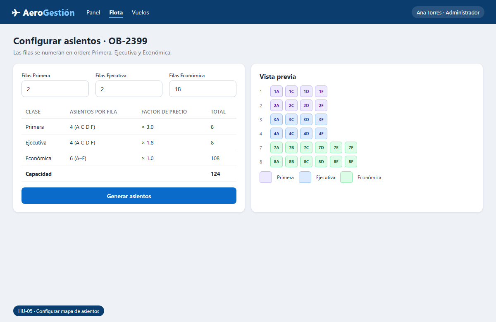

---

### HU-16 · Listar la flota
**Labels:** `historia-de-usuario` `epica:flota` `prioridad:should`
**Estimación:** 2 SP

**Como** administrador
**quiero** ver todos los aviones de la aerolínea
**para** conocer su estado y su capacidad por clase.

#### Criterios de aceptación
- [ ] **Dado** que hay aviones registrados, **cuando** abro *Flota*, **entonces** veo matrícula, fabricante, modelo, año, estado y capacidad.
- [ ] Para cada avión veo cuántos asientos tiene en Primera, Ejecutiva y Económica.

**Notas técnicas:** `GET /api/admin/aviones`

**Mockup:**

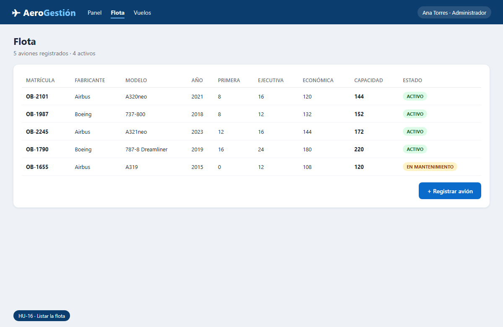

---

### HU-17 · Ver el detalle de un avión
**Labels:** `historia-de-usuario` `epica:flota` `prioridad:could`
**Estimación:** 1 SP

**Como** administrador
**quiero** consultar un avión por su matrícula
**para** revisar sus datos antes de asignarlo a un vuelo.

#### Criterios de aceptación
- [ ] **Dado** una matrícula existente, **cuando** la consulto, **entonces** veo sus datos, su estado y cuántos asientos tiene en cada clase.
- [ ] **Dado** una matrícula que no existe, **cuando** la consulto, **entonces** el sistema responde que no existe (404).

**Notas técnicas:** `GET /api/admin/aviones/{matricula}`

**Mockup:**

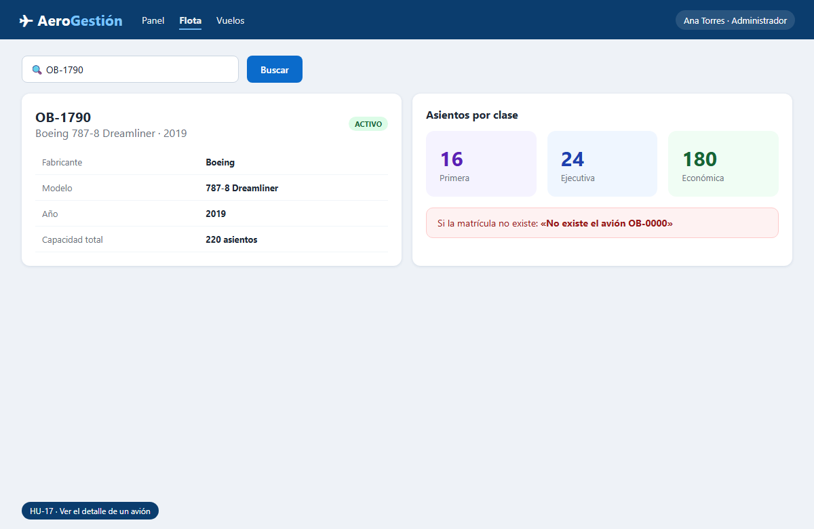

---

## E3: Gestión de vuelos

### HU-06 · Programar vuelo
**Labels:** `historia-de-usuario` `epica:vuelos` `prioridad:must`
**Estimación:** 5 SP

**Como** administrador
**quiero** programar un vuelo indicando código, origen, destino, fecha/hora de salida y llegada, avión y tarifa base
**para** que los pasajeros puedan encontrarlo y reservarlo.

#### Criterios de aceptación
- [ ] **Dado** que ingreso datos válidos, **cuando** guardo el vuelo, **entonces** queda en estado `PROGRAMADO`.
- [ ] **Dado** que el origen y el destino son iguales, **cuando** guardo, **entonces** se rechaza.
- [ ] **Dado** que la llegada es anterior a la salida, **cuando** guardo, **entonces** se rechaza.
- [ ] **Dado** que el avión ya tiene otro vuelo en ese horario o no está `ACTIVO`, **cuando** lo asigno, **entonces** el sistema no lo permite.

**Notas técnicas:** `POST /api/admin/vuelos` · colección `vuelos`

**Mockup:**

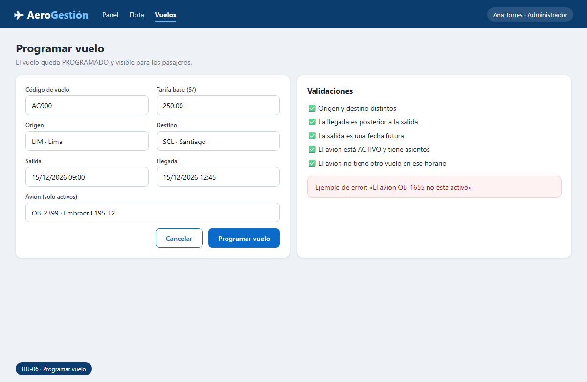

---

### HU-07 · Modificar o cancelar vuelo
**Labels:** `historia-de-usuario` `epica:vuelos` `prioridad:should`
**Estimación:** 5 SP

**Como** administrador
**quiero** modificar el horario o el estado de un vuelo, o cancelarlo
**para** reflejar retrasos y cambios operativos.

#### Criterios de aceptación
- [ ] **Dado** un vuelo `PROGRAMADO`, **cuando** cambio su estado a `RETRASADO` con una nueva hora, **entonces** se actualiza para todos los pasajeros.
- [ ] **Dado** un vuelo con reservas, **cuando** lo cancelo, **entonces** sus reservas pasan a `CANCELADA` y se notifica a los pasajeros por correo.
- [ ] No se puede cancelar un vuelo en estado `EN_VUELO` o `ATERRIZADO`.

**Notas técnicas:** `PUT /api/admin/vuelos/{codigo}`, `PATCH /api/admin/vuelos/{codigo}/estado`, `PATCH /api/admin/vuelos/{codigo}/cancelar`

**Mockup:**

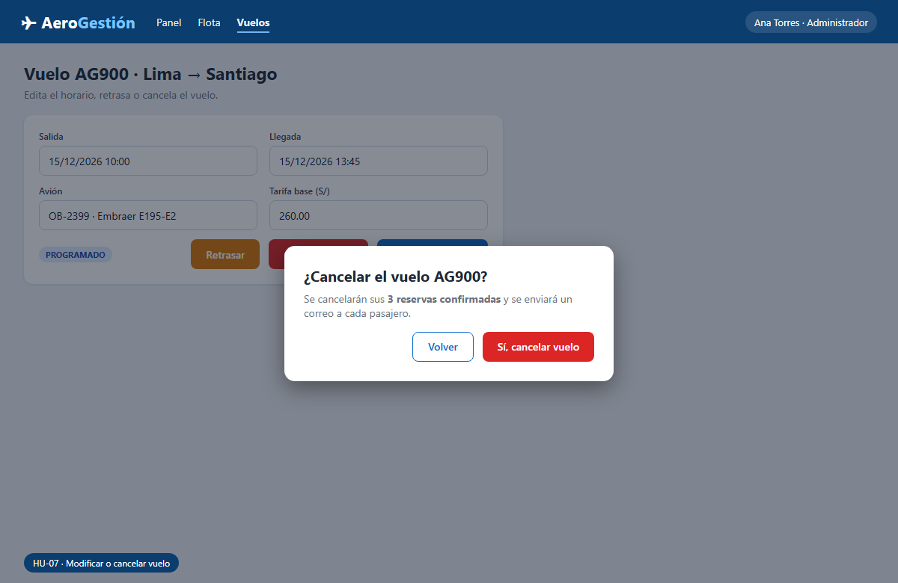

---

### HU-08 · Ver panel de vuelos y ocupación
**Labels:** `historia-de-usuario` `epica:vuelos` `prioridad:could`
**Estimación:** 3 SP

**Como** administrador
**quiero** ver la lista de vuelos con su porcentaje de ocupación
**para** tomar decisiones operativas.

#### Criterios de aceptación
- [ ] **Dado** que hay vuelos, **cuando** abro el panel, **entonces** veo código, ruta, fecha, estado y ocupación (asientos ocupados / capacidad).
- [ ] Veo los indicadores: aviones activos, vuelos de los próximos 7 días, reservas confirmadas y ocupación media.

**Notas técnicas:** `GET /api/admin/resumen`, `GET /api/admin/vuelos?estado=&desde=&hasta=`

**Mockup:**

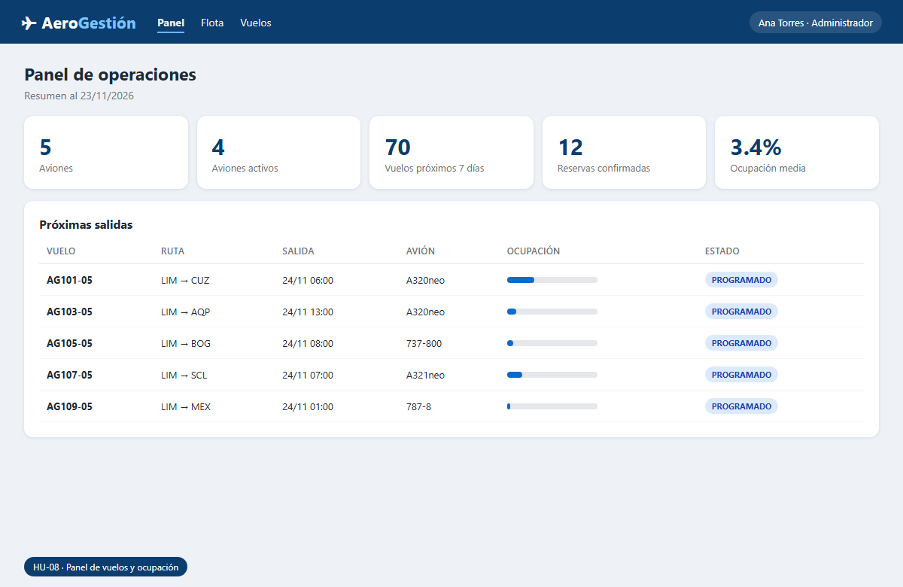

---

### HU-18 · Actualizar el estado operativo de un vuelo
**Labels:** `historia-de-usuario` `epica:vuelos` `prioridad:should`
**Estimación:** 2 SP

**Como** administrador
**quiero** cambiar el estado de un vuelo a `EMBARCANDO`, `EN_VUELO` o `ATERRIZADO`
**para** que el sistema refleje lo que pasa con el vuelo en tiempo real.

#### Criterios de aceptación
- [ ] **Dado** un vuelo `PROGRAMADO` o `RETRASADO`, **cuando** cambio su estado, **entonces** se guarda y se muestra en las consultas.
- [ ] **Dado** que el vuelo pasa a `EMBARCANDO` o posterior, **entonces** ya no admite reservas nuevas.
- [ ] **Dado** un vuelo `CANCELADO`, **cuando** intento cambiar su estado, **entonces** el sistema no lo permite (409).

**Notas técnicas:** `PATCH /api/admin/vuelos/{codigo}/estado`

**Mockup:**

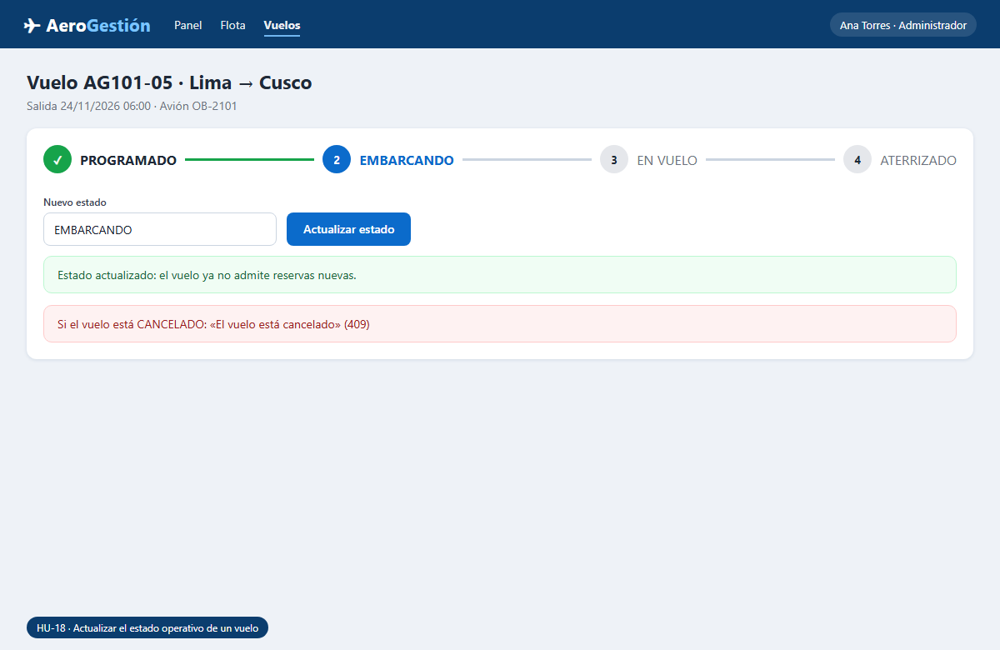

---

### HU-19 · Filtrar vuelos por estado y fechas
**Labels:** `historia-de-usuario` `epica:vuelos` `prioridad:could`
**Estimación:** 2 SP

**Como** administrador
**quiero** filtrar la lista de vuelos por estado y por rango de fechas
**para** encontrar rápido los vuelos que necesito revisar.

#### Criterios de aceptación
- [ ] **Dado** que elijo un estado (ej. `RETRASADO`), **cuando** filtro, **entonces** solo veo vuelos en ese estado.
- [ ] **Dado** un rango de fechas, **cuando** filtro, **entonces** solo veo vuelos que salen en ese rango.
- [ ] Sin filtros veo todos los vuelos ordenados por hora de salida.

**Notas técnicas:** `GET /api/admin/vuelos?estado=&desde=&hasta=`

**Mockup:**

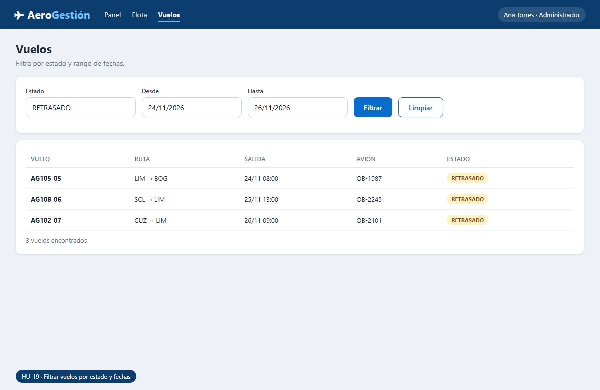

---

## E4: Búsqueda de vuelos

### HU-09 · Buscar vuelos
**Labels:** `historia-de-usuario` `epica:busqueda` `prioridad:must`
**Estimación:** 5 SP

**Como** visitante o pasajero
**quiero** buscar vuelos por ciudad de origen, destino y fecha
**para** encontrar opciones que se ajusten a mi viaje.

#### Criterios de aceptación
- [ ] **Dado** que existen vuelos para esa ruta y fecha, **cuando** busco, **entonces** veo hora de salida y llegada, duración, precio desde (económica) y asientos disponibles.
- [ ] **Dado** que no hay vuelos, **cuando** busco, **entonces** veo *"No hay vuelos disponibles para esta búsqueda"*.
- [ ] Solo se muestran vuelos `PROGRAMADO` o `RETRASADO` con fecha futura.

**Notas técnicas:** `GET /api/vuelos/buscar?origen=LIM&destino=CUZ&fecha=2026-11-15` (público, sin login)

**Mockup:**

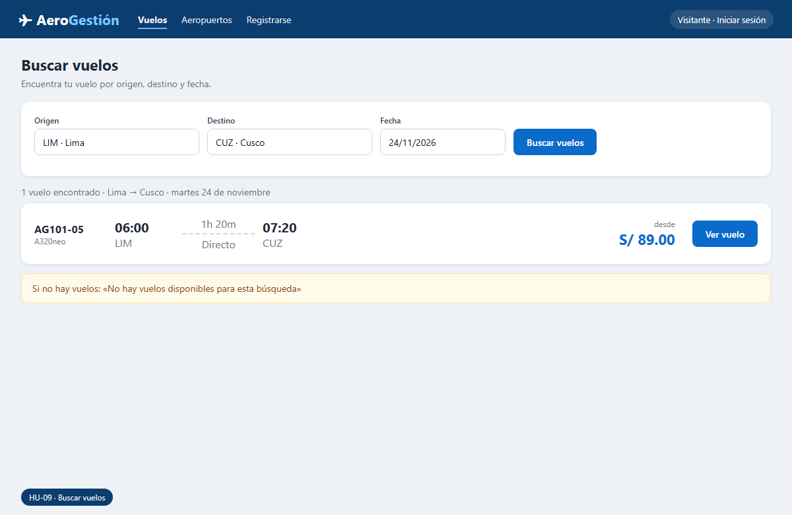

---

### HU-10 · Ver detalle de un vuelo
**Labels:** `historia-de-usuario` `epica:busqueda` `prioridad:should`
**Estimación:** 2 SP

**Como** visitante o pasajero
**quiero** ver el detalle de un vuelo
**para** conocer el avión, la duración y los precios por clase antes de reservar.

#### Criterios de aceptación
- [ ] **Dado** un resultado de búsqueda, **cuando** lo selecciono, **entonces** veo aeropuertos, horarios, duración, modelo de avión y precio por clase.

**Notas técnicas:** `GET /api/vuelos/{codigo}`

**Mockup:**

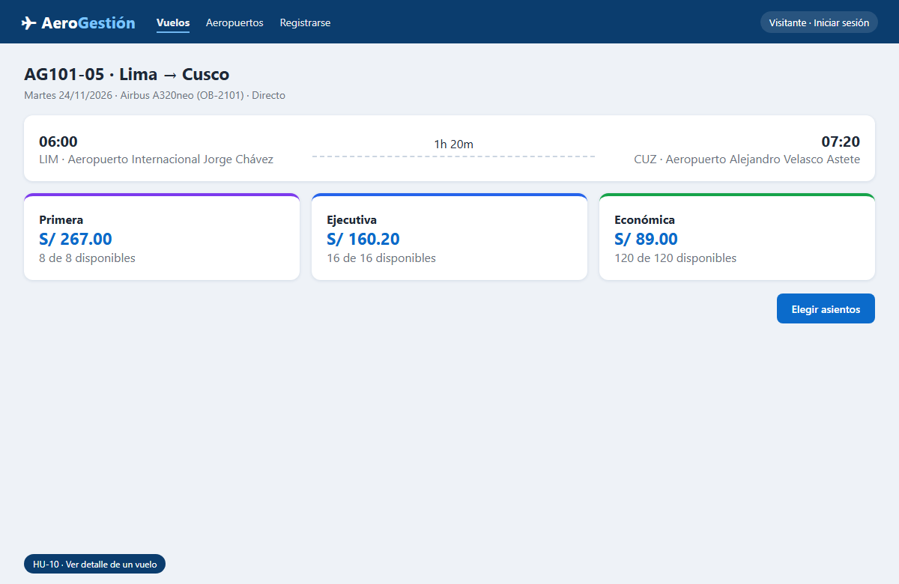

---

### HU-20 · Ver próximas salidas
**Labels:** `historia-de-usuario` `epica:busqueda` `prioridad:could`
**Estimación:** 1 SP

**Como** visitante o pasajero
**quiero** ver los próximos vuelos que salen
**para** encontrar una opción sin tener que buscar ruta y fecha.

#### Criterios de aceptación
- [ ] **Cuando** abro el inicio, **entonces** veo los próximos 10 vuelos abiertos para reservar, ordenados por hora de salida.
- [ ] Cada vuelo muestra ruta, salida, precio desde y asientos disponibles.

**Notas técnicas:** `GET /api/vuelos/proximos` (público, sin login)

**Mockup:**

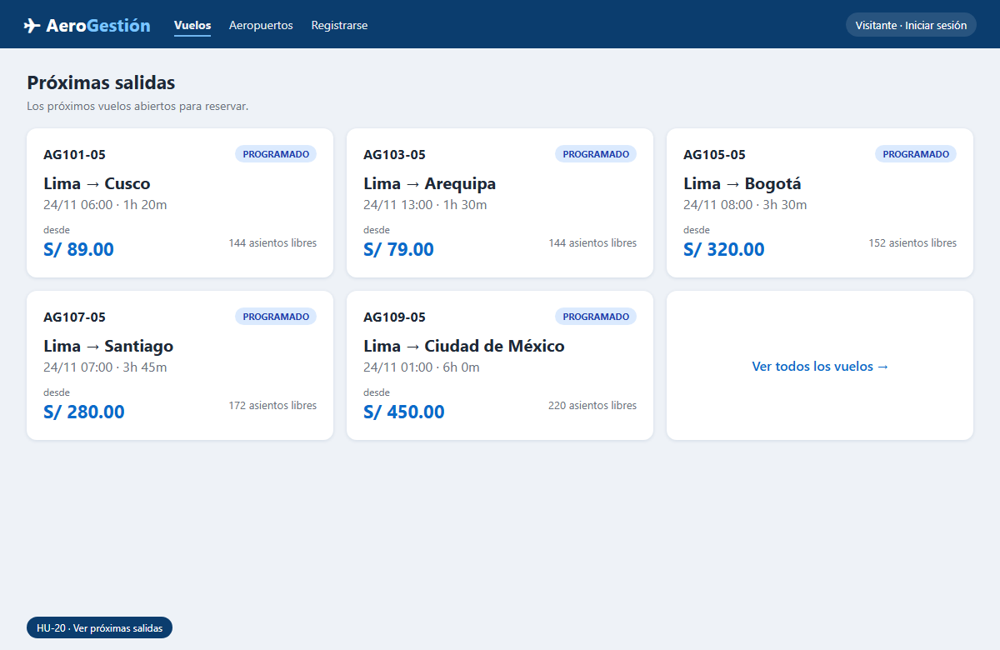

---

### HU-21 · Consultar los aeropuertos disponibles
**Labels:** `historia-de-usuario` `epica:busqueda` `prioridad:could`
**Estimación:** 1 SP

**Como** visitante o pasajero
**quiero** ver la lista de aeropuertos donde opera la aerolínea
**para** saber qué orígenes y destinos puedo buscar.

#### Criterios de aceptación
- [ ] **Cuando** abro el buscador, **entonces** puedo elegir el origen y el destino de una lista con código IATA, ciudad y país.

**Notas técnicas:** `GET /api/aeropuertos` (público, sin login)

**Mockup:**

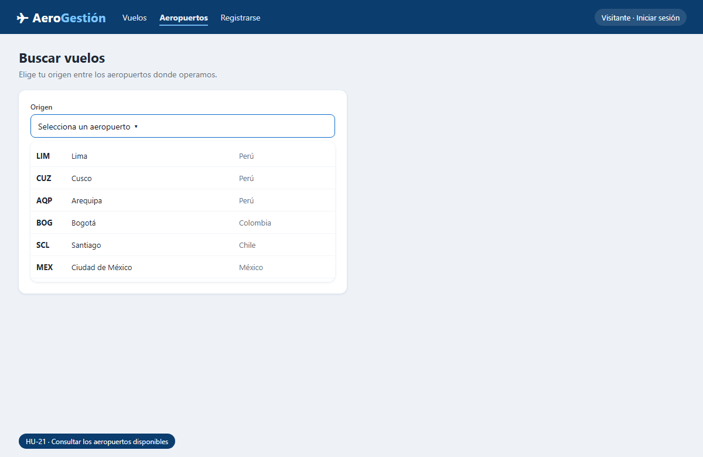

---

### HU-22 · Ordenar los resultados de búsqueda
**Labels:** `historia-de-usuario` `epica:busqueda` `prioridad:could`
**Estimación:** 1 SP

**Como** visitante o pasajero
**quiero** ordenar los vuelos encontrados por precio o por hora de salida
**para** elegir el más barato o el que mejor se ajusta a mi horario.

#### Criterios de aceptación
- [ ] **Dado** una búsqueda con resultados, **cuando** elijo *Precio*, **entonces** se ordenan del más barato al más caro.
- [ ] **Cuando** elijo *Hora*, **entonces** se ordenan por hora de salida (es el orden por defecto).

**Notas técnicas:** `GET /api/vuelos/buscar?...&orden=precio`

**Mockup:**

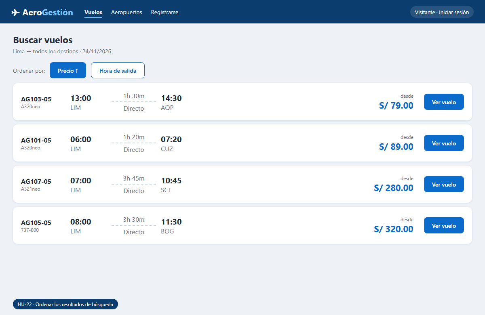

---

## E5: Reservas y asientos

### HU-11 · Seleccionar asiento
**Labels:** `historia-de-usuario` `epica:reservas` `prioridad:must`
**Estimación:** 8 SP

**Como** pasajero
**quiero** ver el mapa de asientos del vuelo y elegir el mío
**para** viajar en el lugar y la clase que prefiero.

#### Criterios de aceptación
- [ ] **Dado** un vuelo, **cuando** abro el mapa, **entonces** veo cada asiento identificado como disponible u ocupado y por clase.
- [ ] **Dado** un asiento ocupado, **cuando** intento seleccionarlo, **entonces** el sistema no lo permite.
- [ ] **Dado** que selecciono un asiento, **entonces** veo su precio (tarifa base × factor de la clase).
- [ ] **Dado** que dos pasajeros eligen el mismo asiento a la vez, **cuando** confirman, **entonces** solo el primero lo obtiene.

**Notas técnicas:** `GET /api/vuelos/{codigo}/asientos`

**Mockup:**

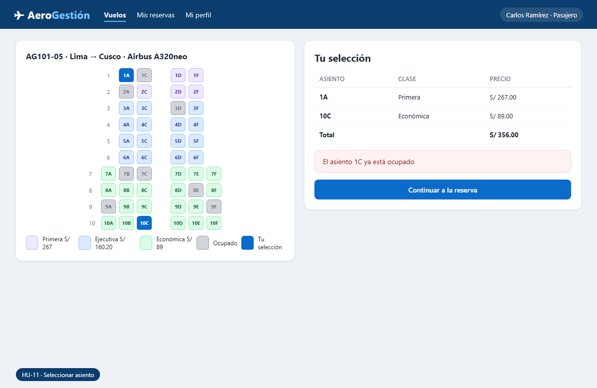

---

### HU-12 · Confirmar reserva
**Labels:** `historia-de-usuario` `epica:reservas` `prioridad:must`
**Estimación:** 5 SP

**Como** pasajero
**quiero** confirmar la reserva de los asientos elegidos
**para** asegurar mi lugar en el vuelo.

#### Criterios de aceptación
- [ ] **Dado** que elegí uno o más asientos disponibles, **cuando** confirmo, **entonces** se crea una reserva `CONFIRMADA` con un código único (ej. `AG-7K2P9X`) y el total calculado.
- [ ] Los asientos reservados quedan ocupados en el vuelo.
- [ ] Recibo un correo de confirmación con el código de reserva.
- [ ] **Dado** que no inicié sesión, **cuando** intento confirmar, **entonces** se me pide iniciar sesión.

**Notas técnicas:** `POST /api/reservas` · colección `reservas`

**Mockup:**

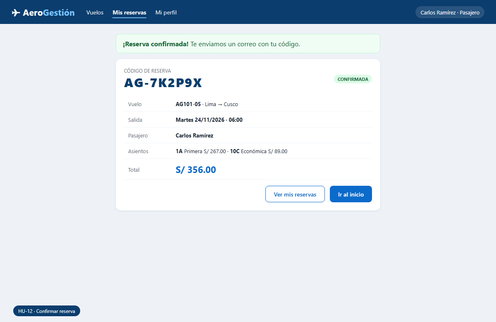

---

### HU-13 · Consultar mis reservas
**Labels:** `historia-de-usuario` `epica:reservas` `prioridad:should`
**Estimación:** 3 SP

**Como** pasajero
**quiero** ver el historial de mis reservas
**para** revisar mis próximos vuelos y los anteriores.

#### Criterios de aceptación
- [ ] **Dado** que tengo reservas, **cuando** abro *Mis reservas*, **entonces** veo código, vuelo, ruta, fecha, asientos, total y estado.
- [ ] Solo veo mis propias reservas, no las de otros pasajeros.

**Notas técnicas:** `GET /api/reservas`

**Mockup:**

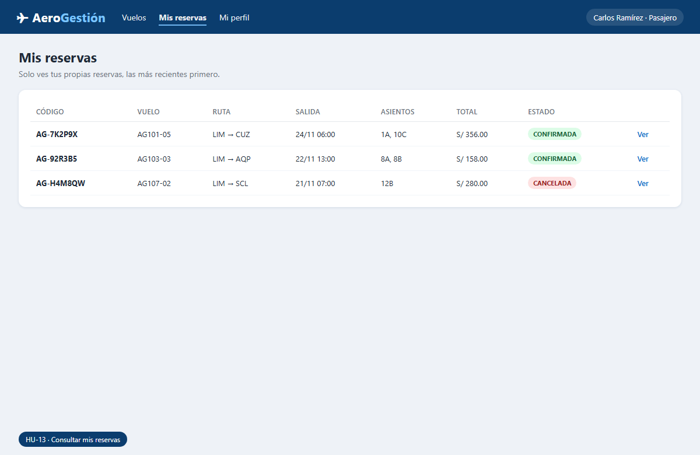

---

### HU-14 · Cancelar reserva
**Labels:** `historia-de-usuario` `epica:reservas` `prioridad:should`
**Estimación:** 3 SP

**Como** pasajero
**quiero** cancelar una reserva
**para** liberar el asiento si ya no voy a viajar.

#### Criterios de aceptación
- [ ] **Dado** que faltan más de 24 horas para el vuelo, **cuando** cancelo, **entonces** la reserva pasa a `CANCELADA` y los asientos vuelven a estar disponibles.
- [ ] **Dado** que faltan menos de 24 horas, **cuando** intento cancelar, **entonces** el sistema no lo permite.
- [ ] Recibo un correo confirmando la cancelación.

**Notas técnicas:** `PATCH /api/reservas/{codigo}/cancelar`

**Mockup:**

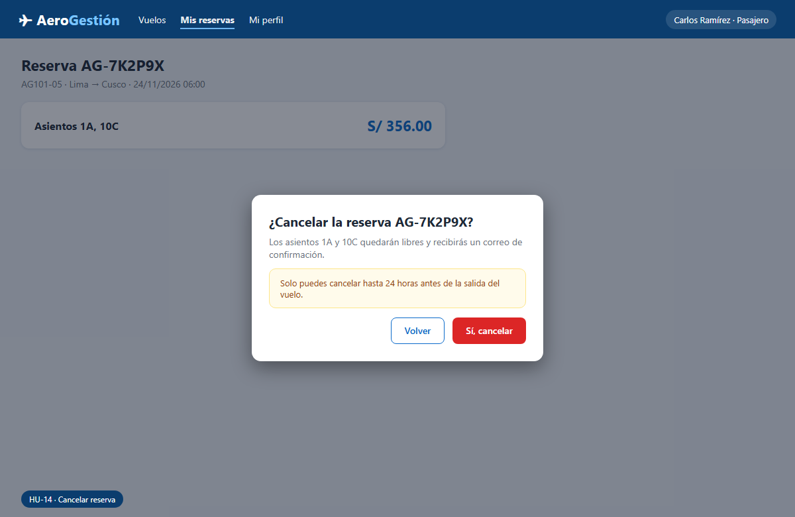

---

### HU-23 · Ver el detalle de una reserva
**Labels:** `historia-de-usuario` `epica:reservas` `prioridad:should`
**Estimación:** 2 SP

**Como** pasajero
**quiero** abrir una de mis reservas con su código
**para** revisar el vuelo, mis asientos, el total y si todavía puedo cancelarla.

#### Criterios de aceptación
- [ ] **Dado** el código de una reserva mía, **cuando** la abro, **entonces** veo vuelo, ruta, salida, asientos con su clase y precio, total, estado y si es cancelable.
- [ ] **Dado** el código de una reserva de otro pasajero, **cuando** la consulto, **entonces** el sistema responde que no existe (404).

**Notas técnicas:** `GET /api/reservas/{codigo}`

**Mockup:**

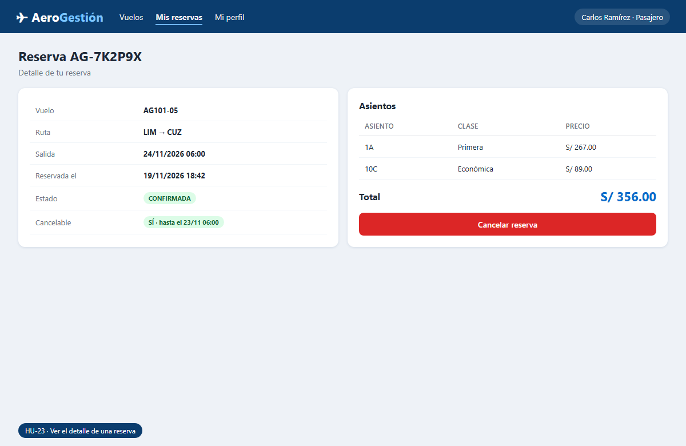

---

### HU-24 · Recibir aviso si la aerolínea cancela mi vuelo
**Labels:** `historia-de-usuario` `epica:reservas` `prioridad:should`
**Estimación:** 2 SP

**Como** pasajero
**quiero** que me avisen por correo si la aerolínea cancela mi vuelo
**para** reorganizar mi viaje a tiempo.

#### Criterios de aceptación
- [ ] **Dado** que tengo una reserva confirmada, **cuando** el administrador cancela el vuelo, **entonces** mi reserva pasa a `CANCELADA` y recibo un correo con el aviso.
- [ ] El vuelo queda en estado `CANCELADO` y ya no admite reservas nuevas.

**Notas técnicas:** se dispara con `PATCH /api/admin/vuelos/{codigo}/cancelar` · `Notificador` / `EmailNotificador`

**Mockup:**

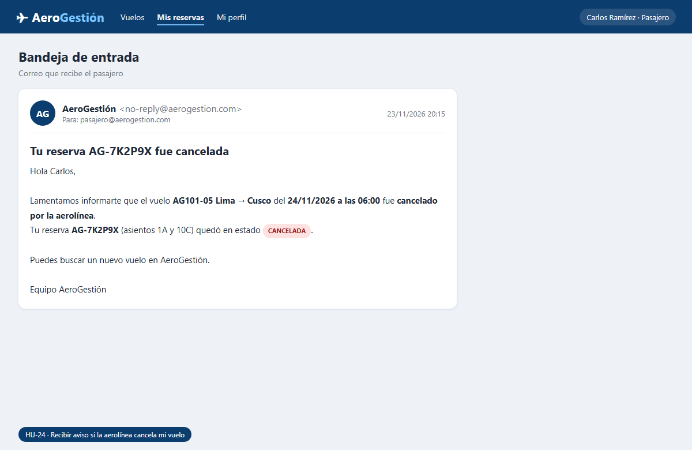

---

## Resumen del backlog

| ID | Historia | Rol | Prioridad | SP |
|---|---|---|---|---|
| HU-01 | Registro de pasajero | Visitante | Must | 3 |
| HU-02 | Inicio de sesión | Pasajero/Admin | Must | 3 |
| HU-03 | Registrar avión | Admin | Must | 5 |
| HU-04 | Actualizar estado de avión | Admin | Should | 3 |
| HU-05 | Configurar mapa de asientos | Admin | Must | 5 |
| HU-06 | Programar vuelo | Admin | Must | 5 |
| HU-07 | Modificar/cancelar vuelo | Admin | Should | 5 |
| HU-08 | Panel de vuelos y ocupación | Admin | Could | 3 |
| HU-09 | Buscar vuelos | Visitante/Pasajero | Must | 5 |
| HU-10 | Ver detalle de vuelo | Visitante/Pasajero | Should | 2 |
| HU-11 | Seleccionar asiento | Pasajero | Must | 8 |
| HU-12 | Confirmar reserva | Pasajero | Must | 5 |
| HU-13 | Consultar mis reservas | Pasajero | Should | 3 |
| HU-14 | Cancelar reserva | Pasajero | Should | 3 |
| HU-15 | Consultar mi perfil | Pasajero/Admin | Could | 1 |
| HU-16 | Listar la flota | Admin | Should | 2 |
| HU-17 | Ver detalle de un avión | Admin | Could | 1 |
| HU-18 | Estado operativo de un vuelo | Admin | Should | 2 |
| HU-19 | Filtrar vuelos por estado y fechas | Admin | Could | 2 |
| HU-20 | Ver próximas salidas | Visitante/Pasajero | Could | 1 |
| HU-21 | Consultar aeropuertos | Visitante/Pasajero | Could | 1 |
| HU-22 | Ordenar resultados de búsqueda | Visitante/Pasajero | Could | 1 |
| HU-23 | Ver detalle de una reserva | Pasajero | Should | 2 |
| HU-24 | Aviso por cancelación de vuelo | Pasajero | Should | 2 |
| | **Total** | | | **73** |
